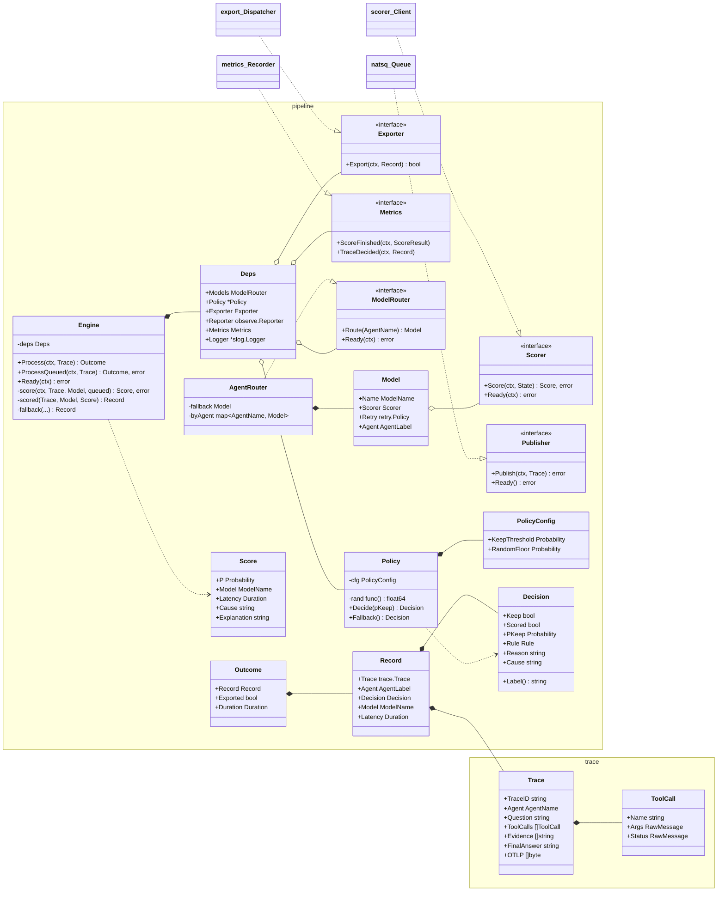
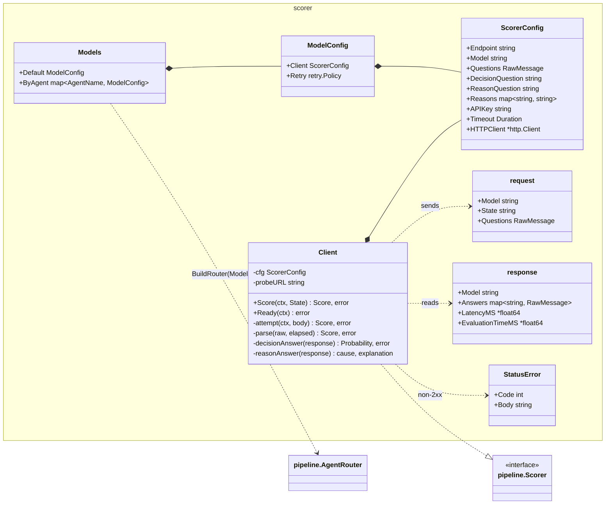
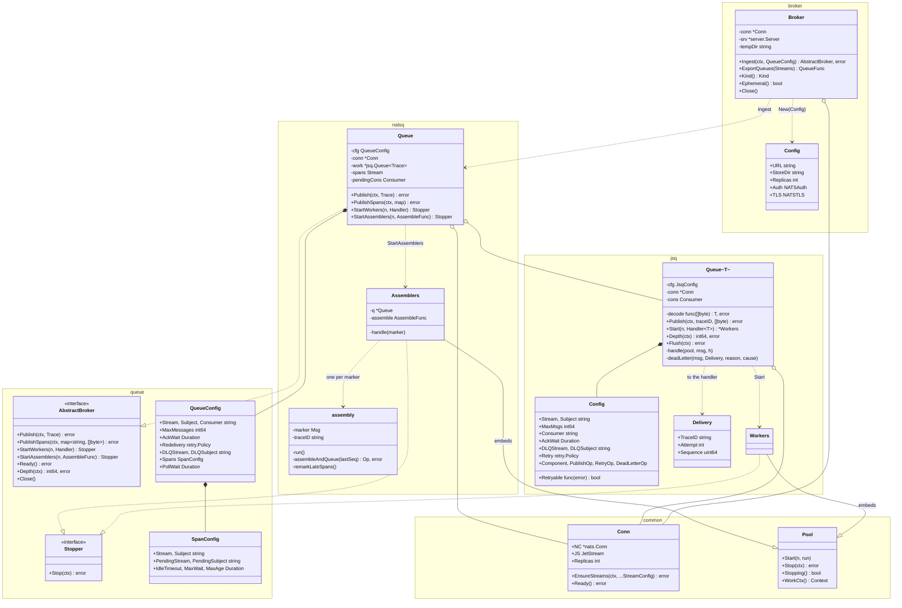
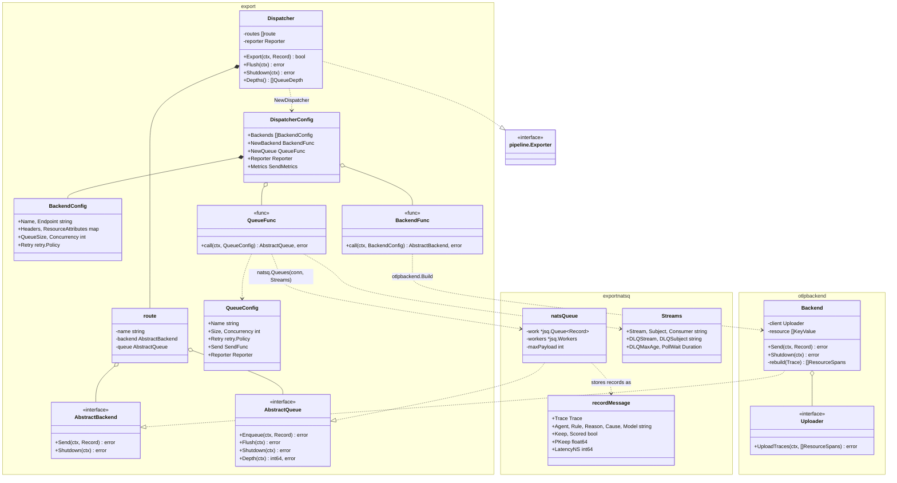
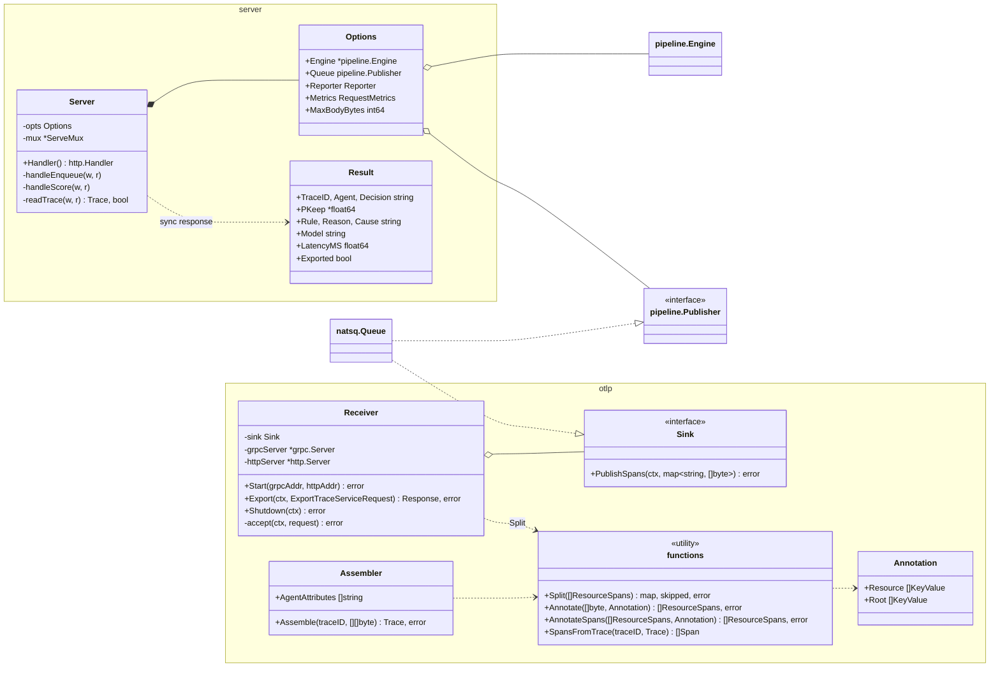
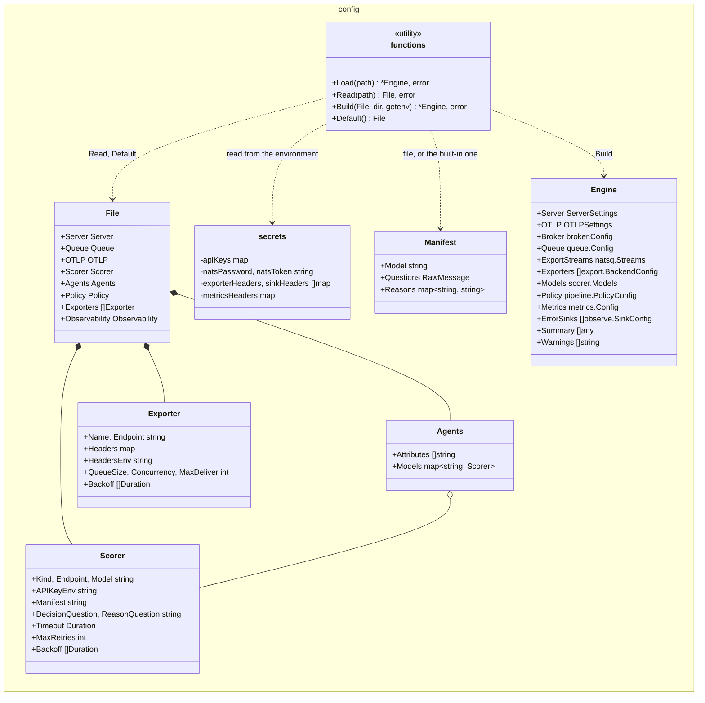
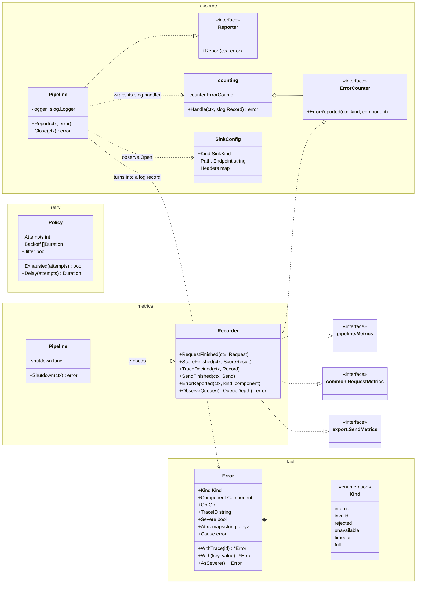

# Class diagrams

The engine's structs and interfaces, grouped by area, with the fields and
methods that matter for how they fit together. Go has no classes: a box is a
struct or an interface, and implementing an interface is implicit, drawn
here as a dashed arrow. Types from other areas appear once more, without
members, where they connect. Where two packages use the same name (several
have a `Config`), the box is named `PackageName` (`ScorerConfig`,
`QueueConfig`, ...).

```
A ..|> B    A implements interface B
A *-- B     A contains B (a field holding it by value)
A o-- B     A holds B (a pointer, interface, slice or map field)
A ..> B     A uses B (takes or returns it)
```

- [1. The core: pipeline](#1-the-core-pipeline)
- [2. Scoring: scorer](#2-scoring-scorer)
- [3. The trace queue: queue, natsq, jsq, broker](#3-the-trace-queue-queue-natsq-jsq-broker)
- [4. Export: export, natsq, otlpbackend](#4-export-export-natsq-otlpbackend)
- [5. Intake: server and otlp](#5-intake-server-and-otlp)
- [6. Configuration: config](#6-configuration-config)
- [7. Errors, observability and metrics](#7-errors-observability-and-metrics)

## 1. The core: pipeline

`pipeline.Engine` runs a trace through route, slice, score, decide
and export. It knows its parts only by the interfaces it declares.



`scorer_Client`, `export_Dispatcher`, `natsq_Queue` and `metrics_Recorder` are
`scorer.Client`, `export.Dispatcher`, `natsq.Queue` (the trace queue) and
`metrics.Recorder`, drawn in full below.

## 2. Scoring: scorer

`scorer.BuildRouter` turns the configured models into `pipeline.Model`s,
each with a `scorer.Client` speaking `/v1/systemone`.



## 3. The trace queue: queue, natsq, jsq, broker

`queue` holds the contract; `natsq` implements it on the generic JetStream
work queue, `jsq.Queue[T]`, which the export queues share. `broker` owns the
one NATS connection, to an external server or an embedded one.



## 4. Export: export, natsq, otlpbackend

`export.Dispatcher` gives each back end its own queue. The back ends and
their queues are built by plain functions (`BackendFunc`, `QueueFunc`).



## 5. Intake: server and otlp

The JSON API and the OTLP receivers both end at the trace queue; `otlp` also
turns stored spans into a `trace.Trace` and annotates them for export.



## 6. Configuration: config

`config.File` is the YAML file as written; `config.Build` turns it into
`config.Engine`, every component's settings in that component's own type.



## 7. Errors, observability and metrics

Every failure is a `fault.Error`. Components report it to an
`observe.Reporter`; `metrics.Recorder` implements every metrics hook the other
packages declare.



`retry.Policy` is the one retry policy everything shares: `queue.Config.Redelivery`
for the trace queue, `export.QueueConfig.Retry` for each back end, and
`pipeline.Model.Retry` for the synchronous endpoint.
