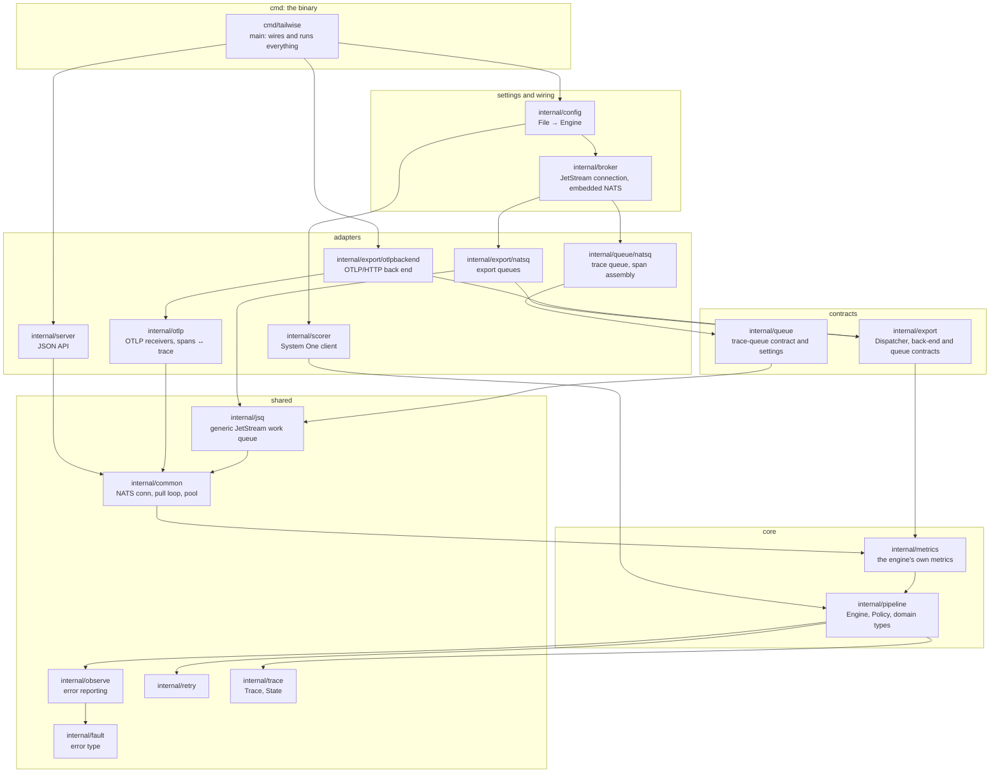
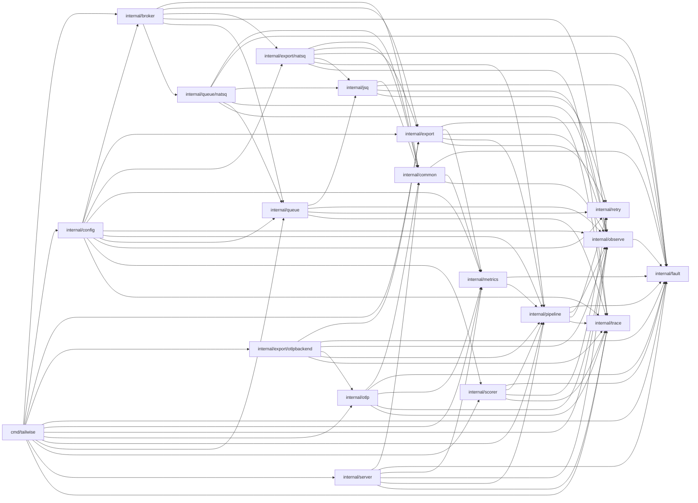

# Package dependency graph

Which of the engine's packages imports which. Both graphs come from
`go list` (test-only packages left out); regenerate them with the commands at
the end when imports change.

- [The layers](#the-layers): every import, minus those already implied by
  another path, which shows the structure
- [Every import](#every-import): all 85 edges
- [What the graph guarantees](#what-the-graph-guarantees)
- [External libraries](#external-libraries)

## The layers

An arrow means "imports". An import that also follows from a longer path is
left out here: `config` imports `pipeline` directly, but also through
`scorer`, so only `config → scorer → pipeline` is drawn.



## Every import



## What the graph guarantees

- **The core imports no adapter.** `pipeline` depends only on `trace`,
  `retry`, `observe` and `fault`. It declares what it needs (`Scorer`,
  `Exporter`, `Publisher`, `Metrics`, `ModelRouter`), and the adapters
  implement those interfaces. A new model server or back end never touches it.
- **Leaves.** `fault`, `retry` and `trace` import nothing of the engine's, so
  any package can use them.
- **Only `main` and `config` see the whole engine.** `config` imports the
  component packages to build their settings (`queue.Config`,
  `broker.Config`, `scorer.Models`, ...), and no component imports `config`.
  `main` wires the components together.
- **NATS stays behind the queue packages.** `internal/jsq`, `internal/common`
  and the two `natsq` packages are the only ones that speak JetStream;
  `broker` chooses between an external server and the embedded one.
- **No cycles.** Go forbids them; the graph is a DAG.

## External libraries

| Package | Uses |
| --- | --- |
| `internal/common`, `internal/jsq`, `internal/queue/natsq` | `nats.go` (the `jetstream` client) |
| `internal/broker` | `nats.go`, `nats-server` (the embedded server) |
| `internal/otlp` | `grpc`, `protobuf`, the OTLP protobuf types, `genproto` (gRPC status) |
| `internal/export/otlpbackend` | the OpenTelemetry OTLP/HTTP trace client and protobuf types |
| `internal/metrics` | the OpenTelemetry metrics SDK and its OTLP/HTTP exporter |
| `internal/observe` | the OpenTelemetry logs SDK, its OTLP/HTTP exporter, the `otelslog` bridge |
| `internal/config` | `yaml.v3` |

Every other package uses the standard library only.

## Regenerating

```sh
# Every import between the engine's packages, as Mermaid edges.
go list -f '{{.ImportPath}} {{join .Imports " "}}' ./... | grep -v queuetest |
  awk -v P=github.com/tecnosam/tailwise/ '{ src = substr($1, length(P) + 1); gsub("/", "_", src)
    for (i = 2; i <= NF; i++) if (index($i, P) == 1 && $i !~ /queuetest/) {
      dst = substr($i, length(P) + 1); gsub("/", "_", dst); print "    " src " --> " dst } }' | sort
```
