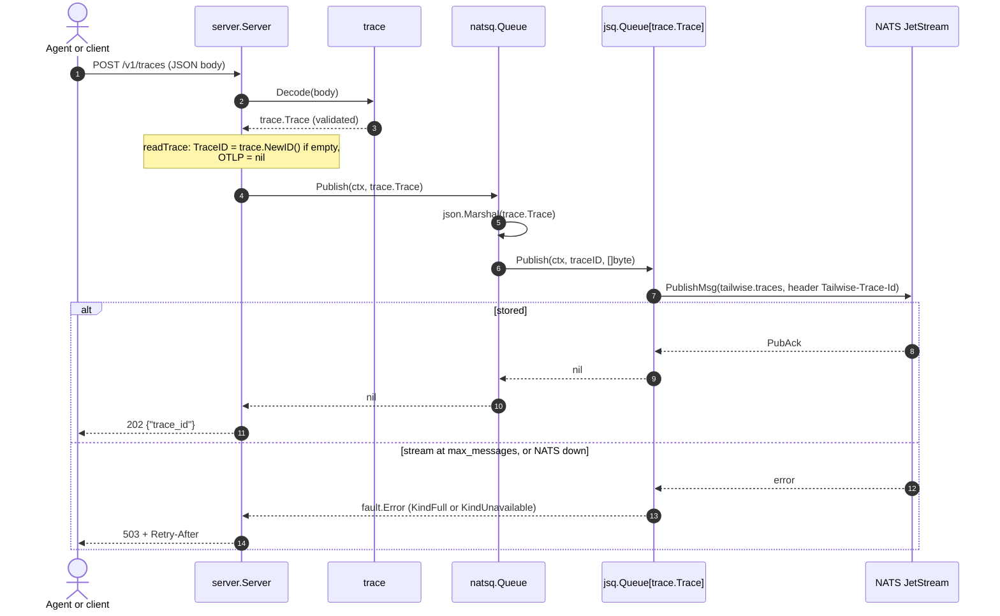
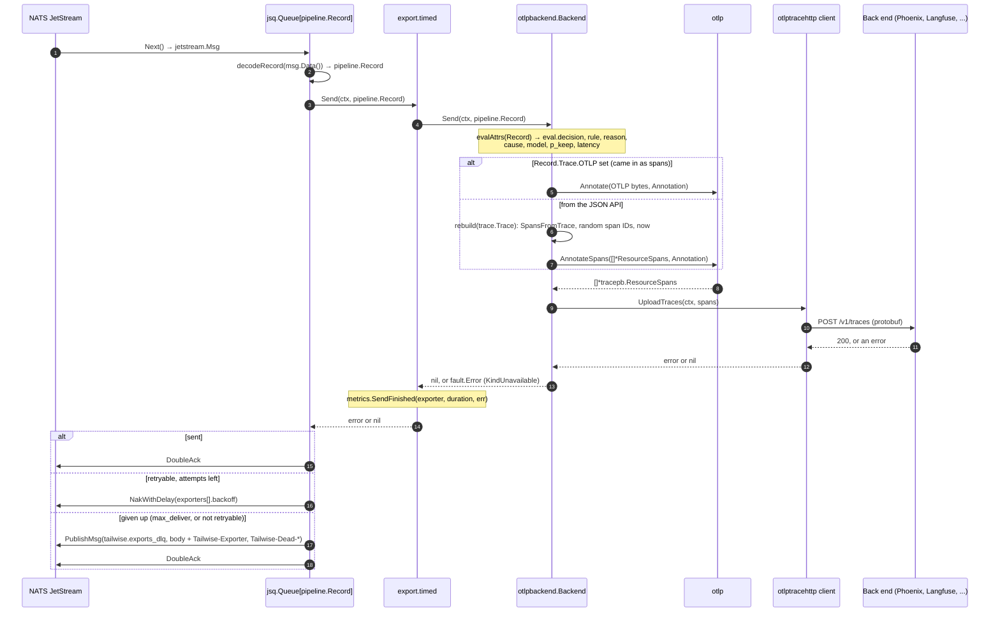
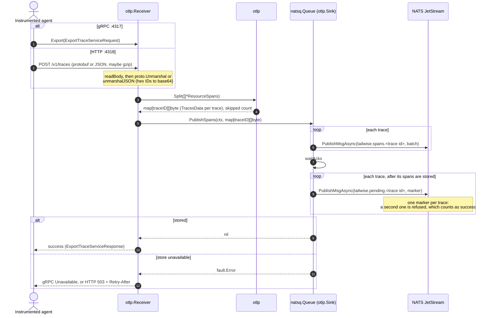
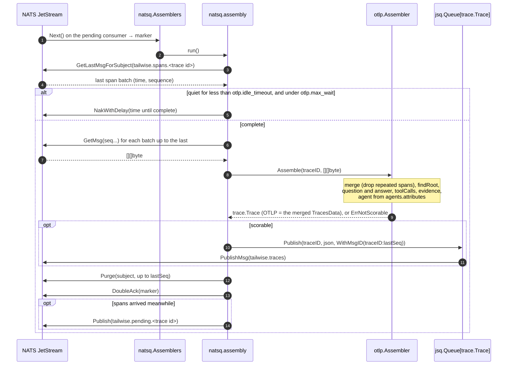
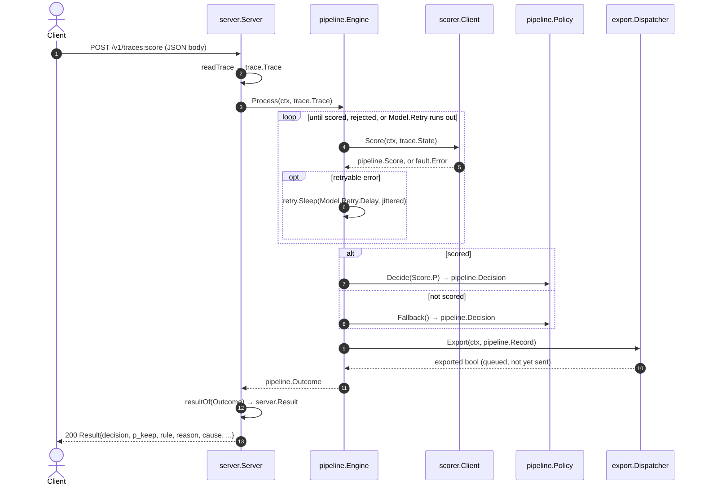
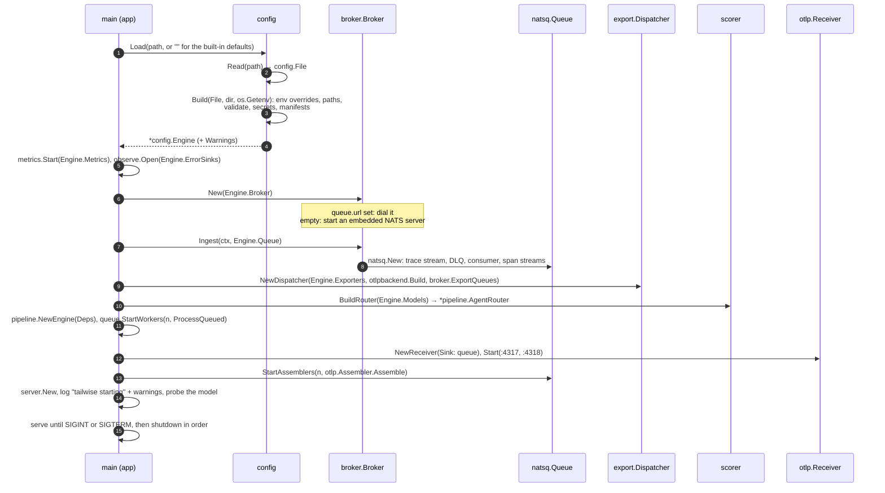

# Sequence diagrams

How one trace moves through the engine, package by package, and what is
passed at each step. The README has the high-level picture; these follow the
calls. Participants are named `package.Type`. Arrows carry the function
called and the value passed or returned.

- [The values passed along](#the-values-passed-along)
- [1. Queued intake: POST /v1/traces](#1-queued-intake-post-v1traces)
- [2. A worker scores a queued trace](#2-a-worker-scores-a-queued-trace)
- [3. An export worker sends a kept trace](#3-an-export-worker-sends-a-kept-trace)
- [4. OTLP intake: spans over gRPC or HTTP](#4-otlp-intake-spans-over-grpc-or-http)
- [5. An assembler turns spans into a trace](#5-an-assembler-turns-spans-into-a-trace)
- [6. Synchronous scoring: POST /v1/traces:score](#6-synchronous-scoring-post-v1tracesscore)
- [7. Start-up: from the config to running components](#7-start-up-from-the-config-to-running-components)

## The values passed along

| Value | Package | What it is | Where it travels |
| --- | --- | --- | --- |
| request body (JSON) | | The client's trace | HTTP into `server.Server` |
| `ExportTraceServiceRequest` | OTLP protobuf | A batch of spans | gRPC or HTTP into `otlp.Receiver` |
| `map[string][]byte` | | Trace ID to a serialized `TracesData` of that trace's spans | `otlp.Split` to the span store |
| `trace.Trace` | `internal/trace` | The agent run: question, tool calls, evidence, final answer, and the original spans in `OTLP` | Intake, the trace queue (as JSON), the engine |
| `trace.State` | `internal/trace` | The trace rendered as the text the model reads | `pipeline.Engine` to `pipeline.Scorer` |
| `request` / `response` | `internal/scorer` | The `/v1/systemone` JSON: model, state, questions; answers per question | `scorer.Client` to and from Jev |
| `pipeline.Score` | `internal/pipeline` | The probability the answer is wrong, model, latency, the chosen cause and its sentence | `scorer.Client` to `pipeline.Engine` |
| `pipeline.Decision` | `internal/pipeline` | Keep or drop, the probability, rule, reason, cause | `pipeline.Policy` and `pipeline.Engine` |
| `pipeline.Record` | `internal/pipeline` | The trace with its decision, agent label, model and latency | The engine to the dispatcher, the export queues (as `recordMessage` JSON), the back ends |
| `pipeline.Outcome` | `internal/pipeline` | The record, whether it was queued for export, and the run's duration | The engine to its caller |
| `jsq.Delivery` | `internal/jsq` | One message as a worker got it: trace ID, attempt, stream sequence | The work queue to its handler |
| `[]*tracepb.ResourceSpans` | OTLP protobuf | Spans annotated with the `eval.*` decision | `otlpbackend.Backend` to the back end |
| `fault.Error` | `internal/fault` | Any failure: kind, component, operation, trace ID, attributes | Returned everywhere; reported to `observe.Reporter` |

## 1. Queued intake: POST /v1/traces

The 202 is sent only after JetStream has stored the trace.



## 2. A worker scores a queued trace

Each of `server.workers` goroutines pulls one message at a time from the
shared durable consumer. The model is called once per delivery; the queue
does the retrying.

```mermaid
sequenceDiagram
    autonumber
    participant JS as NATS JetStream
    participant WQ as jsq.Queue[trace.Trace]
    participant Q as natsq.Queue
    participant Eng as pipeline.Engine
    participant R as pipeline.AgentRouter
    participant Tr as trace
    participant Sc as scorer.Client
    participant Jev as Jev (/v1/systemone)
    participant Pol as pipeline.Policy
    participant D as export.Dispatcher
    participant EQ as export natsq queue

    JS->>WQ: Next() → jetstream.Msg
    WQ->>WQ: decode: trace.Decode(msg.Data()) → trace.Trace
    WQ->>Q: handler(ctx, trace.Trace, *jsq.Delivery)
    Note over Q: no TraceID: queue.SequenceID(stream, d.Sequence)
    Q->>Eng: ProcessQueued(ctx, trace.Trace)
    Eng->>R: Route(trace.Agent)
    R-->>Eng: pipeline.Model (Scorer, Retry, AgentLabel)
    Eng->>Tr: BuildState(trace.Trace)
    Tr-->>Eng: trace.State
    Eng->>Sc: Score(ctx, trace.State)
    Sc->>Jev: POST request{model, state, questions}
    Jev-->>Sc: response{answers: answer_wrong noul, why_wrong choice}
    Note over Sc: decisionAnswer → P<br/>reasonAnswer → Cause, Explanation
    Sc-->>Eng: pipeline.Score, or fault.Error
    alt scored
        Eng->>Pol: Decide(Score.P)
        Pol-->>Eng: pipeline.Decision (Keep, PKeep, Rule)
        Note over Eng: Reason, Cause = Score.Explanation, Score.Cause
        Eng->>D: Export(ctx, pipeline.Record)
        opt Decision.Keep
            loop each back end
                D->>EQ: Enqueue(ctx, pipeline.Record)
                EQ->>JS: PublishMsg(tailwise.exports.<name>, recordMessage JSON)
            end
        end
        D-->>Eng: exported bool
        Note over Eng: metrics.TraceDecided, one "decision" log line
        Eng-->>Q: pipeline.Outcome, nil
        Q-->>WQ: nil
        WQ->>JS: DoubleAck
    else system error (down, timeout, 5xx, 401, 429)
        Eng-->>WQ: fault.Error
        alt attempts left
            WQ->>JS: NakWithDelay(queue.redelivery_backoff)
        else queue.max_deliver reached
            WQ->>JS: PublishMsg(tailwise.traces.dlq, same body + Tailwise-Dead-* headers)
            WQ->>JS: DoubleAck
        end
    else model rejects the trace (400, 413, 422)
        Eng->>Pol: Fallback()
        Pol-->>Eng: pipeline.Decision (Rule fallback, random keep)
        Note over Eng: exported as above; the queue acknowledges
    end
```

## 3. An export worker sends a kept trace

Each back end has its own queue and `exporters[].concurrency` workers. A
send is one OTLP/HTTP request; the export queue retries it.



## 4. OTLP intake: spans over gRPC or HTTP

The exporter gets a success only once every span batch is stored.



## 5. An assembler turns spans into a trace

A marker stays unacknowledged while its trace is still receiving spans, then
the trace joins the queue of diagram 2.



## 6. Synchronous scoring: POST /v1/traces:score

No trace queue: the engine scores in the request and retries a system error
itself. A kept trace still goes through the export queues of diagram 3.



## 7. Start-up: from the config to running components

`config` turns the file into each component's own settings; `main` wires
them, then serves.


